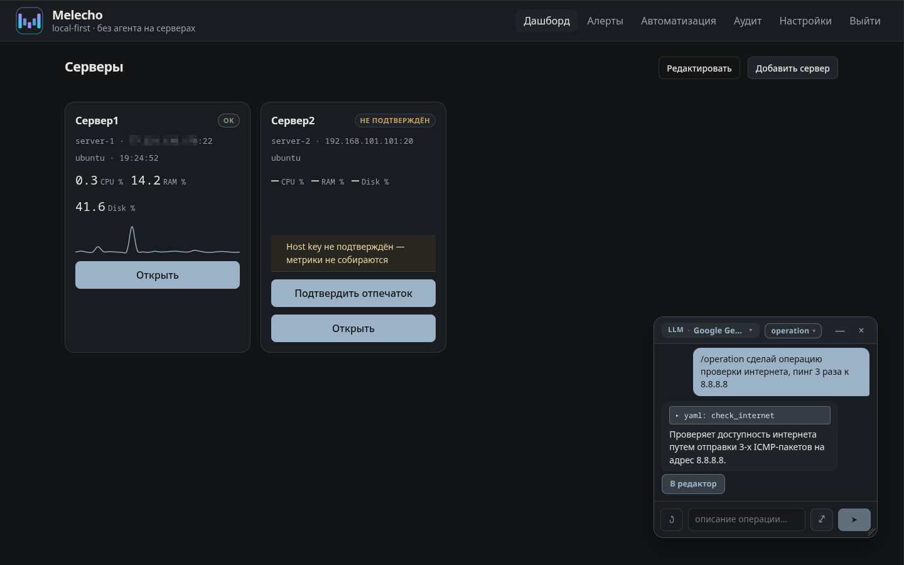

# Melecho

Локальная ИС управления Linux-серверами через SSH: метрики,
алерты, автоматические реакции, интерактивный граф связей,
HMAC-аудит и LLM-ассистент. Local-first, без агента на серверах.

<p align="center">
  
</p>

## Возможности

- **Без агентов на серверах:** работает поверх стандартного SSH (`asyncssh`), не открывает лишних портов.
- **Безопасность по умолчанию:** мастер-пароль (Argon2id + AES-256-GCM), строгий TOFU + pre-flight проверка host key, HMAC-цепочка аудита с ключом вне БД, локальный периметр (`127.0.0.1`).
- **Изолированные профили:** несколько рабочих пространств с экспортом и импортом в зашифрованный архив `.melecho`.
- **Мониторинг и детектор аномалий:** метрики (per-server интервалы и сроки хранения), EWMA + z-score с фильтром фонового шума и пресетами чувствительности.
- **Операции и автоматизация:** параметризованный YAML-каталог с декларативным форматированием, потоковые команды с остановкой (`Ctrl+C`), правила алертов, реакции, автосудо и граф связей.
- **LLM-ассистент:** объяснение алертов и правил, генерация YAML-операций и правил алертов/реакций без передачи секретов и реальных адресов.

---

## Установка на Linux

### Через `pipx` (рекомендуется)

```bash
pipx install melecho
melecho
```

- **Как работает:** приложение запускается в фоне (демон) и само открывает браузер с одноразовой ссылкой доступа.
- **Управление:** `melecho --status`, `melecho --stop`, `melecho --install-desktop` (или тумблер ярлыка в *Настройки → Общие*).
- **Особенности:** нативный доступ к вашим ключам в `~/.ssh`; обновление командой `pipx upgrade melecho`.
- **Если команда `melecho` не найдена:** добавьте `~/.local/bin` в `$PATH`:
  - `bash`: `export PATH="$HOME/.local/bin:$PATH"` в `~/.bashrc`
  - `zsh`: то же в `~/.zshrc`
  - `fish`: `fish_add_path $HOME/.local/bin`

### Из исходников (`git`)

```bash
git clone https://github.com/Rusaell/melecho.git
cd melecho
./run.sh
```

- **Как работает:** скрипт `run.sh` сам создаст `.venv`, установит зависимости и запустит Melecho. Повторный запуск — мгновенный. Для вывода логов прямо в терминал используйте `./run.sh --foreground`.
- **Особенности:** это единственный канал, поддерживающий **автоматическое обновление прямо из веб-интерфейса** (*Настройки → Обновления → «Обновить и остановить»*).

### Через Docker (`docker-menu.sh`)

```bash
git clone https://github.com/Rusaell/melecho.git
cd melecho
./docker-menu.sh
```

- **Как работает:** скачивает готовый образ из `ghcr.io/rusaell/melecho:latest` (или собирает локально при отсутствии сети), открывает браузер и запускает интерактивное меню управления контейнером.
- **Особенности:** не требует Python 3.11+ на хосте; база и ключи хранятся в Docker-томах; для подключения по SSH к самой хост-машине из контейнера используйте адрес `host.docker.internal`.

---

## Установка на Windows (10 / 11 через Docker Desktop)

Нативная установка без Docker на Windows не поддерживается — запуск идёт внутри изолированного Linux-контейнера.

**Требования:** установленный и запущенный [Docker Desktop](https://www.docker.com/products/docker-desktop/) (WSL2, статус *Engine running*).

### Быстрый запуск (без Git и без настройки PowerShell)

1. Скачайте со страницы [Releases](https://github.com/Rusaell/melecho/releases/latest) 3 файла в одну папку:
   - `docker-compose.yml`
   - `docker-menu.bat`
   - `docker-menu.ps1`
   *(Либо клонируйте репозиторий полностью: `git clone https://github.com/Rusaell/melecho.git` или скачать архив репозитория на сайте и извлечь)*
2. **Дважды кликните по `docker-menu.bat`**.

**Особенности запуска на Windows:**
- `docker-menu.bat` автоматически выставляет кодировку `UTF-8` и обходит ограничение PowerShell `ExecutionPolicy` только для текущего окна — **права администратора не требуются**.
- При первом запуске готовый образ автоматически скачается с `ghcr.io/rusaell/melecho:latest` и запустится строго локально на `127.0.0.1:8765`, после чего откроется браузер со ссылкой входа.
- **Сохранность данных:** база профилей, ключ аудита и загруженные ключи хранятся внутри именованных Docker-томов в WSL2 (права `0600` и SQLite WAL работают корректно, независимо от NTFS).
- **Синхронное закрытие:** если в веб-интерфейсе нажать *«Выйти → Остановить и выйти»*, контейнер завершится и окно `docker-menu.bat` закроется автоматически, дополнительных действий не требуется.
- **Получение новой ссылки:** если закрыли вкладку браузера, нажмите `1` в окне меню (или выполните `docker compose exec melecho melecho --no-browser`).

---

## Работа с SSH-ключами

Во всех вариантах установки приватные SSH-ключи **никогда не хранятся в базе данных SQLite**:
1. **Локальный путь:**
   - **При нативном запуске на Linux (`pipx` / `./run.sh`):** можно указать любой путь к ключу на вашей машине (файлы из `~/.ssh` автоматически появятся в быстрых подсказках под полем ввода).
   - **При запуске через Docker:** контейнер изолирован от диска хоста, поэтому произвольные пути вашей ОС (вроде `C:\Users\...` или `/home/user/...`) в нём недоступны. Положите нужные ключи в папку `./ssh` рядом с `docker-compose.yml` — они появятся в списке как `/root/.ssh/...` (либо пробросьте свою папку в `docker-compose.yml`).
2. **Загрузка в профиль:** нажмите *«Загрузить в профиль…»* рядом с полем ключа. Файл зашифруется мастер-ключом профиля (`AES-256-GCM`) в защищённом файле `keys/*.enc` (`0600`) и будет расшифровываться только в оперативной памяти при подключении. При экспорте профиля в `.melecho` такие ключи безопасно переносятся вместе с ним.

---

## Лицензия

GPL-3.0-or-later. См. [LICENSE](LICENSE).